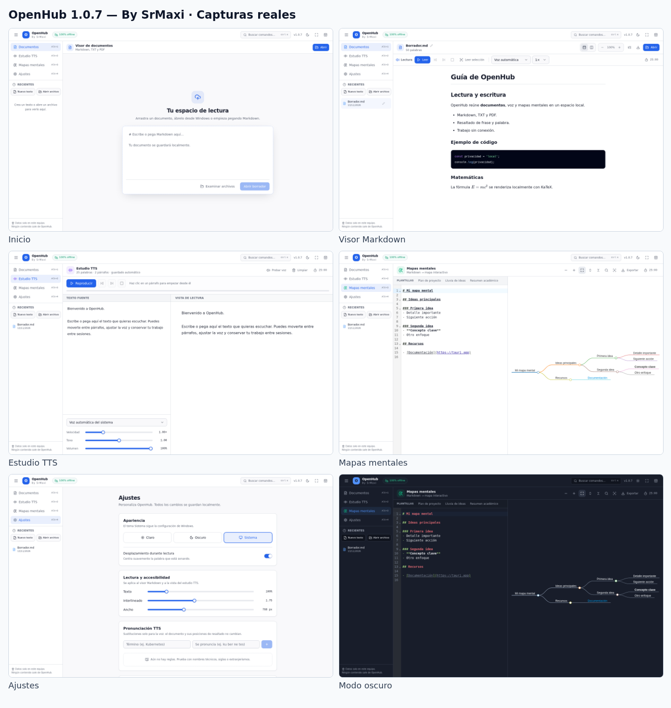

# OpenHub — By SrMaxi

Aplicación de escritorio **Windows 10/11**, que integra un visor Markdown/PDF, un estudio de texto a voz y mapas mentales interactivos. Todo el trabajo y los recursos funcionan offline; solo buscar o descargar actualizaciones requiere internet. Construida con **Tauri v2, Rust, React 18, TypeScript, Tailwind CSS, Radix UI y Zustand**.

## Funcionalidades

- **Documentos:** Markdown, TXT y PDF; diálogo nativo, drag & drop, historial, editor dividido, GFM, código y KaTeX; zoom con `Ctrl + rueda` (y botones `− / % / +` o `Ctrl + 0`) en Markdown/TXT/editor y PDF; cambio de nombre visible dentro de la app haciendo clic en la barra superior o desde Recientes sin alterar los archivos del disco.
- **PDF local:** PDF.js y worker empaquetados; zoom con `Ctrl + rueda` o botones, ajuste, páginas, búsqueda global y capa de texto seleccionable.
- **Voz:** Web Speech API / voces SAPI disponibles en WebView2; velocidad, tono, volumen, atajo `Espacio` para pausar/reanudar la lectura activa sin interferir al escribir, lectura de selección, párrafos, progreso, resaltado (incluidos títulos/subtítulos Markdown y enlaces) y auto-scroll.
- **Mapas:** CodeMirror 6 + Markmap, zoom, pan, colapso, modo foco, plantillas y exportación MD/SVG/HTML/PNG/PDF mediante impresión.
- **Pomodoro compartido:** trabajo/descanso configurables, pausa, salto, reinicio, estadísticas y alarma local diferente al terminar enfoque o descanso. Panel flotante accesible sobre Visor, TTS y Mapas.
- **Productividad:** pantalla completa nativa/web global con botón y `F11` (incluso con la barra superior oculta), creación de textos y apertura de archivos desde Recientes, paleta `Ctrl+K`, barra superior ocultable con `Ctrl+Shift+H`, índice Markdown, búsqueda PDF y búsqueda/centrado de temas Markmap.
- **Lectura accesible:** tamaño, interlineado y ancho configurables; pronunciación TTS personalizada sin alterar el texto ni perder su resaltado.
- **Respaldo local:** exportación/restauración JSON versionada y validada de preferencias, pronunciaciones y recientes.
- **Actualizaciones firmadas:** aviso al iniciar, descarga con progreso, instalación con aceptación y reinicio mediante GitHub Releases. [Configuración](docs/ACTUALIZACIONES.md).
- **Privacidad:** sin cuentas, analítica ni recursos remotos. El estado se conserva en `localStorage` de WebView2; únicamente el actualizador contacta GitHub Releases.

El análisis comparativo, las decisiones de diseño, las fuentes y la matriz de verificación están en [Investigación y mejoras](docs/INVESTIGACION-Y-MEJORAS.md).

## Capturas reales

Las siguientes imágenes son capturas directas del **build de producción ejecutado en Chromium**, no mockups ni imágenes generadas por IA. El mismo frontend se empaqueta dentro de WebView2 en Windows.



Capturas individuales a 1440 × 900 px: [Inicio](docs/screenshots/01-inicio.png) · [Visor Markdown](docs/screenshots/02-visor-markdown.png) · [Estudio TTS](docs/screenshots/03-estudio-tts.png) · [Mapas mentales](docs/screenshots/04-mapas-mentales.png) · [Ajustes](docs/screenshots/05-ajustes.png) · [Modo oscuro](docs/screenshots/06-mapa-modo-oscuro.png).

**Nuevas mejoras verificadas:** [Paleta de comandos](docs/screenshots/mejoras/07-paleta-comandos.png) · [Índice de lectura](docs/screenshots/mejoras/08-indice-lectura.png) · [Búsqueda PDF en página 2](docs/screenshots/mejoras/09-busqueda-pdf.png) · [Búsqueda Markmap](docs/screenshots/mejoras/10-busqueda-markmap.png) · [Pronunciación y accesibilidad](docs/screenshots/mejoras/11-pronunciacion-ajustes.png) · [Barra superior oculta](docs/screenshots/mejoras/12-barra-superior-oculta.png) · [Leer selección](docs/screenshots/mejoras/13-leer-seleccion.png) · [Actualización disponible](docs/screenshots/mejoras/14-actualizacion-disponible.png) · [Pomodoro superpuesto](docs/screenshots/mejoras/15-pomodoro-superpuesto.png) · [Acciones en Recientes](docs/screenshots/mejoras/16-recientes-acciones.png) · [Pantalla completa](docs/screenshots/mejoras/17-pantalla-completa.png) · [Zoom en Markdown](docs/screenshots/mejoras/18-zoom-markdown.png) · [Renombrar documento](docs/screenshots/mejoras/19-renombrar-documento.png) · [Subrayado TTS en títulos](docs/screenshots/mejoras/20-subrayado-titulos.png).

### Cómo escuchar solo una selección

1. Selecciona texto con el ratón en la vista previa, en el editor Markdown o en la capa de texto del PDF.
2. Pulsa **Leer selección**. El botón muestra cuántos caracteres hay seleccionados y conserva la selección al hacer clic.
3. Los controles de pausa, detener, anterior y repetir respetan ese fragmento; no vuelven al documento completo. Si no hay selección, la aplicación muestra instrucciones y no inicia la voz.

## Requisitos

- Windows 10/11 para la aplicación nativa.
- Node.js 22.12 o superior (Node 22 LTS).
- Rust 1.90 o superior (`rustup`) y [requisitos de Tauri v2](https://v2.tauri.app/start/prerequisites/).
- Microsoft WebView2 (normalmente ya incluido en Windows 11).

## Desarrollo

```powershell
npm ci
npm run dev             # Solo frontend: http://localhost:1420
npm run tauri dev       # Escritorio + hot reload
```

El modo navegador incluye fallback para abrir y descargar archivos. Las rutas nativas, imágenes `asset://` y algunas voces dependen de Tauri/WebView2.

## Verificación y build

```powershell
npm run typecheck
npm test
npm run build
npm run tauri build
# Auditoría opcional de dependencias de producción
npm audit --omit=dev --audit-level=low
```

La verificación E2E opcional y reproducible de las nuevas funciones está documentada en [Investigación y mejoras](docs/INVESTIGACION-Y-MEJORAS.md#reproducir-verificación-de-navegador). Playwright es únicamente una herramienta de QA, no una dependencia del runtime.

Instaladores generados:

```text
src-tauri/target/release/bundle/nsis/OpenHub_1.0.7_x64-setup.exe
src-tauri/target/release/bundle/msi/OpenHub_1.0.7_x64_en-US.msi
```

> Los nombres pueden variar según la arquitectura y el idioma del bundle.

## Compilar en GitHub

1. Crea un repositorio y sube todo el contenido de esta carpeta:

   ```powershell
   git init
   git add .
   git commit -m "OpenHub 1.0.7"
   git branch -M main
   git remote add origin https://github.com/USUARIO/REPOSITORIO.git
   git push -u origin main
   ```

2. Abre la pestaña **Actions**. El workflow `Build OpenHub para Windows` se ejecuta en cada push a `main` y también manualmente mediante **Run workflow**.
3. Para activar releases y actualizaciones, completa primero [la configuración de secretos y OpenH-updates](docs/ACTUALIZACIONES.md). Cada push a `main` publica una release firmada; los PR solo compilan y prueban.
4. Al terminar, descarga el artifact **`openhub-windows-<versión>`** o el instalador de la release pública correspondiente.

## Estructura

```text
src/
├── components/
│   ├── layout/       # Shell, navegación, ajustes y ErrorBoundary
│   ├── tools/        # Visor, TTS, Markmap y Pomodoro
│   └── ui/           # Controles accesibles estilo Shadcn/Radix
├── hooks/            # TTS, filesystem, Markmap y Pomodoro
├── services/         # Wrappers Tauri/Web Speech
├── store/            # Zustand + persist
├── lib/              # Mapeo DOM, texto y exportación
├── App.tsx           # Lazy loading y conservación de vistas
└── main.tsx
src-tauri/            # Rust, permisos, assets y bundle
.github/workflows/    # Build Windows y artefactos
```

## Notas técnicas

- El visor se carga al inicio. TTS, Markmap, Ajustes y PDF.js se dividen en chunks; las vistas ya visitadas no se desmontan.
- El resaltado usa **CSS Custom Highlight API**. El fallback dibuja elementos `<mark>` superpuestos, sin modificar los nodos de texto ni romper los offsets TTS.
- Las imágenes Markdown relativas se resuelven respecto al archivo mediante `convertFileSrc`.
- El HTML exportado de Markmap incluye el SVG y controles propios de zoom/pan; no necesita internet.
- Para exportar PDF se abre la impresión del sistema: elige **Microsoft Print to PDF**.
- Las voces disponibles dependen de las voces instaladas en Windows. Algunas voces no emiten eventos `boundary`; OpenHub incluye una estimación de progreso para esos casos.

## Licencia

Proyecto privado (`"private": true`). Todos los derechos reservados salvo que el propietario indique lo contrario.
